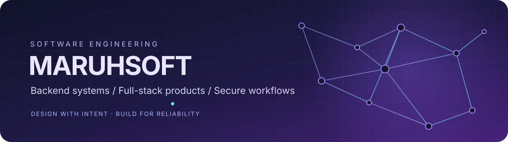

<!-- PROFILE BANNER -->

  

<h1 align="center">Maruhsoft</h1>

  <strong>Software Engineer · Backend Systems · Full-Stack Applications</strong>

  
  
  
  

<h2>01 / Engineering focus</h2>
<table>
  <tr>
    <td width="50%" valign="top">
      <h3>Backend engineering</h3>
      
Application architecture, API design, business logic, data access, service integrations and background processing.

    </td>
    <td width="50%" valign="top">
      <h3>Full-stack products</h3>
      
Responsive interfaces connected to secure, dependable backend workflows and well-defined data contracts.

    </td>
  </tr>
  <tr>
    <td width="50%" valign="top">
      <h3>Financial systems</h3>
      
Transaction lifecycles, wallet operations, ledger integrity, deposits, conversions, withdrawals and auditability.

    </td>
    <td width="50%" valign="top">
      <h3>Security & operations</h3>
      
Authentication, authorization, validation, testing, CI/CD, deployment workflows and production troubleshooting.

    </td>
  </tr>
</table>

<h2>02 / Selected projects</h2>
<table>
  <tr>
    <th align="left" width="28%">Project</th>
    <th align="left">What it demonstrates</th>
    <th align="left" width="18%">Links</th>
  </tr>
  <tr>
    <td valign="top"><strong>Exqpay</strong> </td>
    <td>Crypto-to-fiat and gift-card platform. Public project documentation covers wallet and deposit workflows, transaction accounting, conversions, withdrawals and audit logging.</td>
    <td><a href="https://exqpay.com/">Live platform</a> <a href="https://github.com/Maruhsoft/exqpay_live">Public repository</a></td>
  </tr>
  <tr>
    <td valign="top"><strong>University Education Management Portal</strong> </td>
    <td>Academic workflow MVP with student course registration, lecturer result entry, departmental review and result publication.</td>
    <td><a href="https://uemp-mvp.maruhsoft.workers.dev/">Live MVP</a> <a href="https://github.com/Maruhsoft/UEMP">Source code</a></td>
  </tr>
  <tr>
    <td valign="top"><strong>Secure Multi-Tenant API System</strong> </td>
    <td>Architecture blueprint exploring tenant isolation, authentication and authorization, API controls, validation, auditability and operational security.</td>
    <td><a href="https://github.com/Maruhsoft/secure-multi-tenant-API-system">Repository</a></td>
  </tr>
  <tr>
    <td valign="top"><strong>Giga Maps</strong> </td>
    <td>Exploration through forks of UNICEF's school-connectivity mapping frontend and backend repositories.</td>
    <td><a href="https://github.com/Maruhsoft/giga-maps-frontend">Frontend fork</a> <a href="https://github.com/Maruhsoft/giga-maps-backend">Backend fork</a></td>
  </tr>
</table>

<h2>03 / GitHub statistics</h2>

  
  

  

  

Statistics are generated by external GitHub README services and may occasionally be unavailable or delayed.

<h2>04 / Technologies</h2>

  
  
  
  
  
  

  
  
  
  
  
  

<h2>05 / Engineering principles</h2>
<table>
  <tr><td align="center" width="25%"><strong>01</strong> Model the domain</td><td align="center" width="25%"><strong>02</strong> Protect the source of truth</td><td align="center" width="25%"><strong>03</strong> Design for failure</td><td align="center" width="25%"><strong>04</strong> Test complete workflows</td></tr>
</table>

Clear responsibilities. Validated operations. Auditable state changes. Maintainable systems that can be operated in production.

<h2>06 / Milestones & recognition</h2>
<table>
  <tr><th align="left">Milestone</th><th align="left">Evidence</th></tr>
  <tr><td>Live product delivery</td><td><a href="https://exqpay.com/">Exqpay</a> and the <a href="https://uemp-mvp.maruhsoft.workers.dev/">UEMP live MVP</a></td></tr>
  <tr><td>Public engineering work</td><td><a href="https://github.com/Maruhsoft">Public repositories</a> across financial workflows, application architecture and academic systems</td></tr>
</table>

Awards, certifications and formal recognitions are intentionally not fabricated. Verified entries can be added when their names, awarding organisations and years are available.

<h2>07 / Connect</h2>
<table>
  <tr><td><strong>Portfolio</strong></td><td><a href="https://vulcancodeworks.org/">vulcancodeworks.org</a></td></tr>
  <tr><td><strong>LinkedIn</strong></td><td><a href="https://www.linkedin.com/in/maruh-akporowho-647159124/">Maruh Akporowho</a></td></tr>
  <tr><td><strong>Email</strong></td><td><a href="mailto:maruhsoft@gmail.com">maruhsoft@gmail.com</a></td></tr>
</table>

<strong>Design with intent. Build for reliability.</strong> Maruhsoft · Software Engineering

